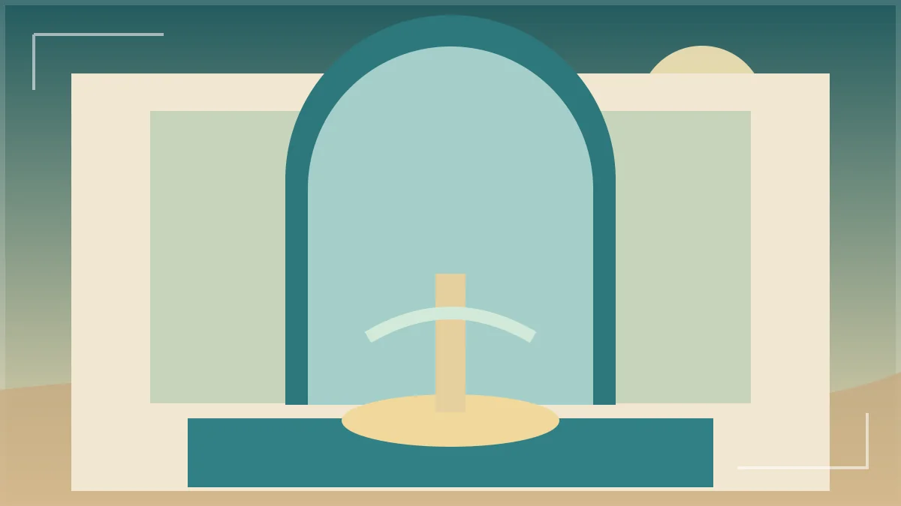
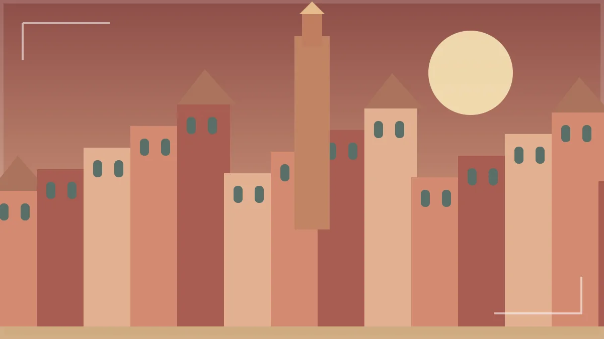
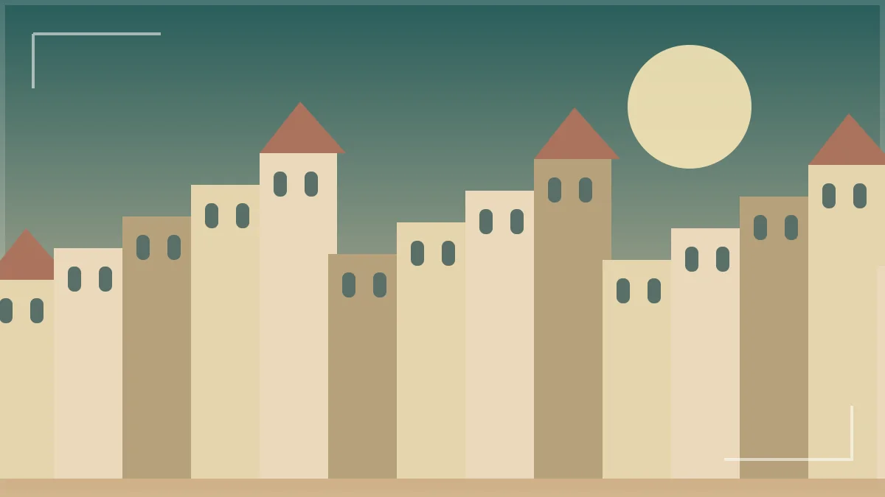
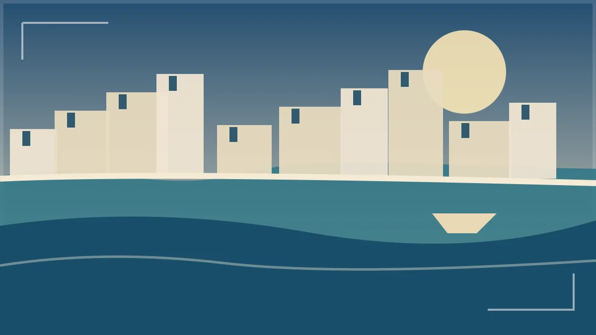
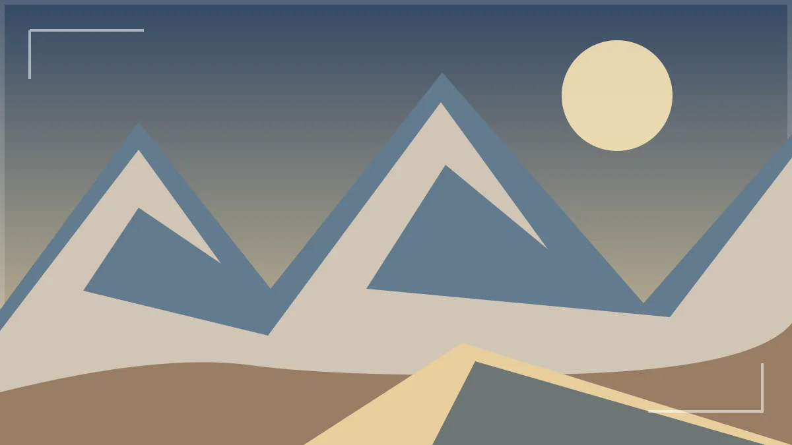
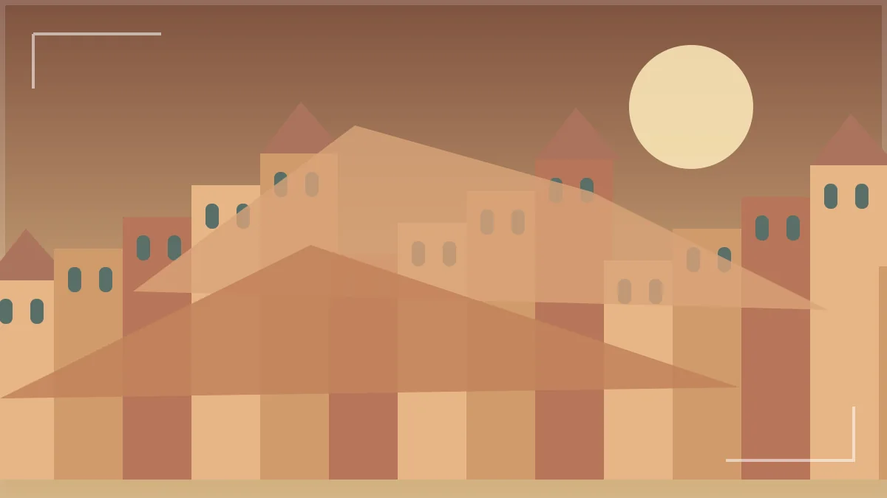
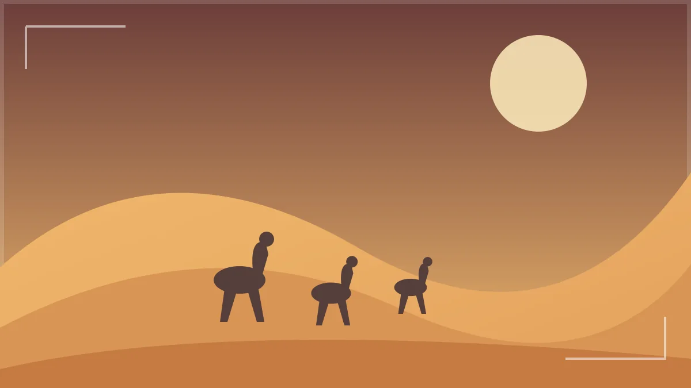
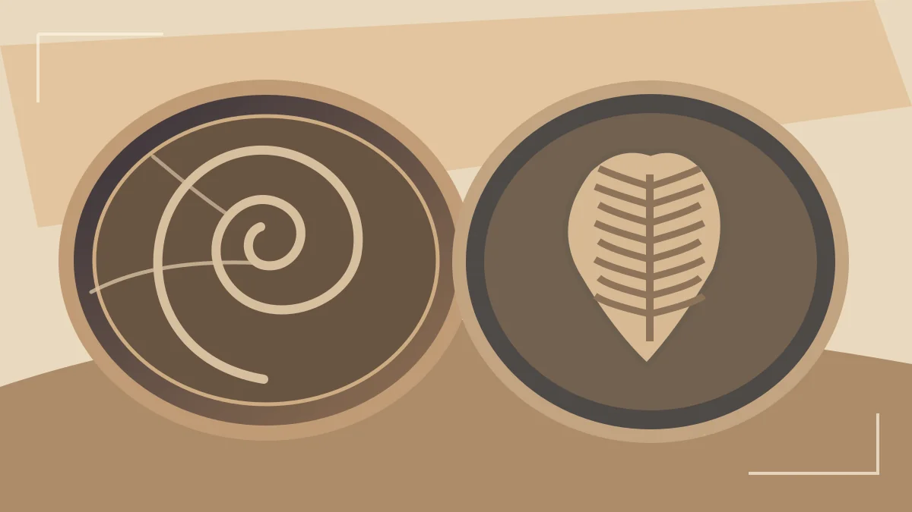
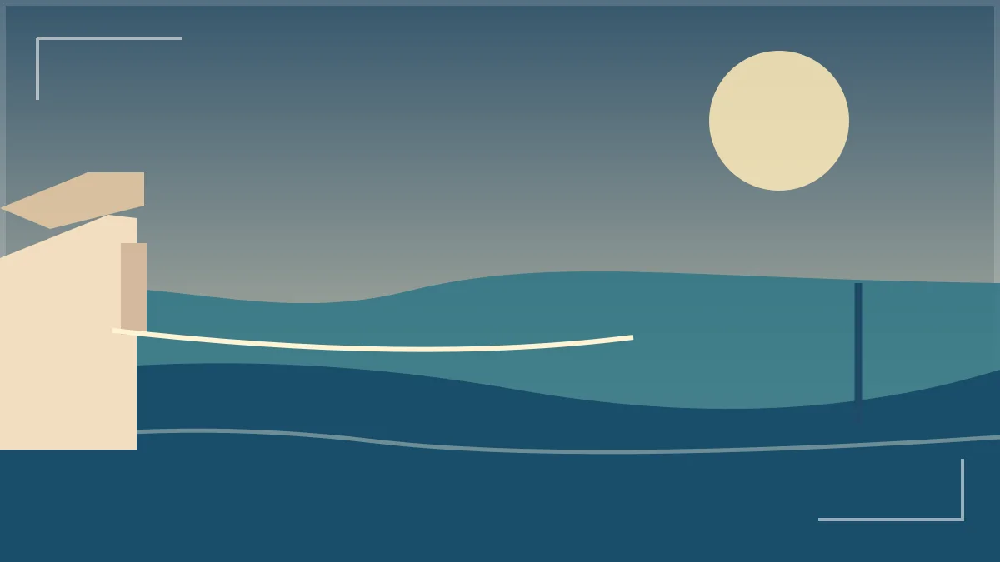
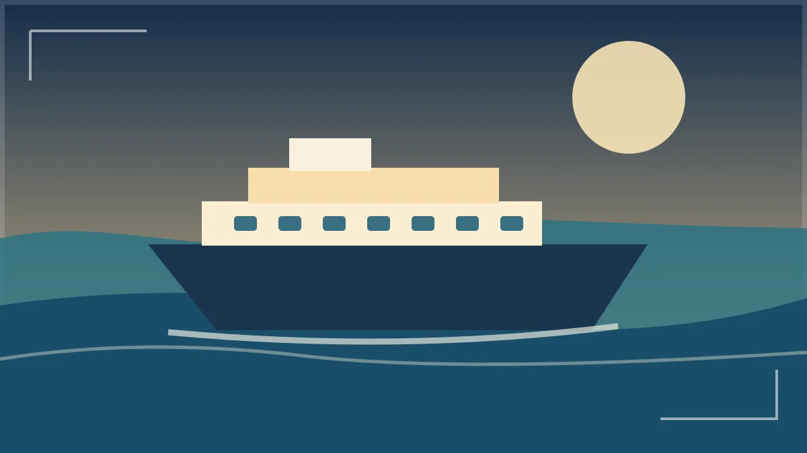

# A Comprehensive Guide to Morocco Tours

*Original post: June 16, 2024. Substantially refreshed: October 13, 2026.*

## A Comprehensive Guide to Morocco Tours: Plan a Trip That Fits You

A great Morocco tour is not about collecting as many places as possible. It is about waking up in a quiet riad, hearing the first sounds of a medina, sharing a fresh meal after a mountain drive, and reaching the dunes with time to enjoy the sunset. This guide makes those moments easier to plan.

If you are visiting Morocco for the first time, start with three questions: **How many nights do I have? Where will I arrive? What do I most want to experience?** Your answers shape the route far more than a list of famous attractions.

You will find practical routes from the USA, Spain and Portugal, along with plans starting in Casablanca, Tangier and Marrakech. We also explain desert camps, food, tour costs, cultural manners and what to ask before booking. The goal is to help you travel with curiosity and without unnecessary stress.

- **Who this guide is for:** First-time guests who want a clear starting point
- **Families and couples:** Travelers who need a comfortable pace and flexible days
- **Desert explorers:** Visitors dreaming of Erg Chebbi without surprise driving times
- **Culture lovers:** People who prefer meaningful stops over rushed photos

*Moroccan riad courtyard — editorial illustration, not a photograph.*

## Why Choose Morocco for Your Next Tour?

One of the pleasures of traveling here is how quickly the scene changes. A morning may begin with the energy of a market and end beneath the soft light of an old courtyard. On a longer route, you can see fertile plains, cedar forests, wide mountain passes, palm-filled valleys and Sahara dunes.

**Culture is part of everyday life**, not something kept only inside museums. Bakers carry trays of bread to neighborhood ovens, craftspeople work in old medinas, and local families gather around mint tea. A good guide can explain what you are seeing without turning every stop into a shopping visit.

The distances are important, though. Morocco may appear compact on a map, but mountain roads are winding and a desert trip usually needs several days. A satisfying tour takes geography seriously and leaves time to enjoy the people and places along the way.

> The best souvenir from a journey is often a small story you did not expect to bring home.

## Three Days, One Week or Two Weeks: How Long Is Enough?

The right number of days depends on what you want to see. Three days can be wonderful for one city and a nearby excursion. Seven days can connect Marrakech, the High Atlas and the Sahara. Ten to fourteen days allow more time for the north, imperial cities and coast. Trying to do everything in one short holiday usually creates too many hours in the vehicle.

Think about **nights, not only days**. An evening arrival and an early departure can take two calendar days off the time you have for sightseeing. Families with young children and travelers who want a gentle pace should also allow a little extra breathing room.

| Length | Best use | What to know |
| --- | --- | --- |
| 3–4 days | A city break or one focused region | Usually too short for a relaxed multi-city Sahara circuit |
| 5–7 days | One regional route or a south-Morocco loop | Choose fewer stops and plan overnight locations carefully |
| 8–10 days | Cities plus a Sahara circuit | Allows a mix of culture, scenery and travel days |
| 12–14 days | Northern cities, desert, mountains and perhaps coast | More comfortable for a wider cross-country route |

If you are unsure, browse our [one-week travel inspiration](/one-week-in-morocco/) and compare it with [longer Morocco tour ideas](/tour/). A route with a little free time often feels richer than a packed one.

## Marrakech: The Best Beginning for a Colorful City Break

Marrakech is full of movement. Step into the medina and the city becomes a mix of little workshops, busy lanes, old doorways and the smell of grilled food. Later, Jemaa el-Fnaa changes character as evening approaches. It is exciting, but it can also feel intense on the first afternoon.

Give yourself time to enjoy Bahia Palace, traditional courtyards, the Koutoubia area and a few streets of the souk without treating them like a race. Jardin Majorelle is popular and may require planning ahead. A calm rooftop lunch or time in your riad can provide a pleasant break from the bustle.

If you arrive from a long flight, keep day one gentle. A guided introduction on the next morning can make the medina less confusing and more enjoyable. For practical clothing advice, read our [guide to what to wear in Marrakech](/marrakech-what-to-wear/); for tour planning, see [how to choose a Marrakech tour company](/best-marrakech-tour-company/).

*Marrakech city views — editorial illustration, not a photograph.*
> **A better first day:** Arrange your transfer, check in, walk one familiar route near your riad and save the major sightseeing for after a good night's sleep.

## Fes: Follow the History, Crafts and Small Details

Fes feels different from Marrakech. Its old city is a maze of lanes where daily life and traditional trades continue side by side. You might pass a small bakery, hear metalworkers in a workshop or discover a carefully carved doorway almost hidden behind a turning street.

A local guide is especially valuable here. With help, places such as the Bou Inania Madrasa and artisan quarters become stories rather than just names. Some religious buildings are not open to non-Muslim visitors, so check access and respect local rules. Ask before taking close-up photographs of craftspeople or residents.

Plan at least one full day for the old medina if you can. Walking is part of the experience, and it is better to enjoy a few places carefully than rush through them. If you are also continuing to the Sahara, leave enough time for the long journey toward Midelt and Erfoud instead of treating it as a short afternoon transfer.

*Historic Fes — editorial illustration, not a photograph.*

## Chefchaouen: Take Your Time in the Blue Streets

Chefchaouen is a mountain town that encourages a slower pace. Blue-washed lanes, stairways, small plazas and views of the Rif hills make it a favorite for gentle walks and photography. The most pleasant moments often happen away from the busiest corners.

Stay overnight if your schedule allows. You can enjoy the blue streets before the largest day-trip crowds arrive and settle into a relaxed evening in town. Wear comfortable footwear: steep lanes and steps are part of the charm, but they may be tiring for anyone with mobility needs.

Chefchaouen works particularly well between Tangier and Fes on a northern itinerary. It does not fit naturally into every Marrakech-based short tour, and adding it without considering road time can make the holiday feel hurried. The best route depends on where your flight or ferry arrives.

*Blue-painted lanes of Chefchaouen — editorial illustration, not a photograph.*

## Casablanca: More Than Just an Airport Arrival

Casablanca is a modern coastal city with lively neighborhoods, cafés and a busy commercial rhythm. Visitors often know it for the impressive Hassan II Mosque, whose position beside the Atlantic makes it one of the country's most recognizable sights. Visitor access and guided tour times should be checked before you plan your day.

Casablanca can be a sensible starting point when your international flight arrives there. Rather than immediately attempting a very long drive after flying, consider an overnight stay, a relaxed walk along the coast, and perhaps a city visit the following morning.

From Casablanca, trips can head north to Rabat, Chefchaouen and Fes or travel south toward Marrakech. See our [Casablanca travel agency planning guide](/exploring-trusted-casablanca-travel-agency/) and a [12-day Casablanca-to-Marrakech journey](/tour/12-days-morocco-tour-from-casablanca-to-marrakech/) to understand how a longer route can flow.

## Rabat and Meknes: A Calmer Look at Moroccan History

Rabat is the capital, with a different rhythm from Marrakech. The Kasbah of the Udayas, Hassan Tower and waterfront make it rewarding for a half-day or full day on a northern journey. Parks and open spaces offer useful breaks if you are traveling with children.

Meknes is another historic imperial city. It can be paired with nearby Volubilis on a route between Rabat and Fes. The Roman archaeological site offers a window into an earlier part of this region's story, especially if you enjoy mosaics, ruins and landscapes.

Not every trip needs both cities. On a short journey, choose the place that fits your route best. On a ten- or twelve-day tour, these stops can connect the larger destinations into a more interesting story, with fewer unexplained hours on the road.

- **Rabat:** Coastal capital, historic kasbah and more open walking areas
- **Meknes:** Imperial history and easy pairing with surrounding heritage
- **Volubilis:** Roman ruins and mosaics in an open landscape
- **Best pacing:** A northern touring day rather than a rushed detour from the south

## Tangier: A Natural Starting Point from Europe

Tangier feels like a meeting point between coastlines and cultures. Explore its old kasbah, waterfront, medina lanes and cafés, or plan a nearby outing to Asilah or Tetouan. It is a good first stop if you reach the country by ferry from Spain or fly directly into the north.

Two port names matter: **Tangier Ville and Tangier Med are not the same place**. Tangier Ville is close to the city center; Tangier Med is well outside town and usually requires a longer onward transfer. Always match your transport plan to the exact port on the ticket.

For a northern route, Tangier can connect naturally with Chefchaouen, Fes and Rabat. A Sahara extension is possible, but it needs additional days. Our [Morocco tours from Spain guide](/morocco-tours-from-spain/) explains ferry choices and practical routes in more detail.

*Tangier and its waterfront — editorial illustration, not a photograph.*
> **Before you book a ferry:** Check the arrival port, passport rules, car or pedestrian ticket conditions, and onward pickup point. Do not assume every Tangier ferry arrives in the city center.

## The Atlas Mountains: Enjoy the Journey Between Places

The High Atlas region introduces some of the most striking scenery on a southbound tour. Roads climb through changing mountain landscapes, passing villages, terraced fields and broad views. Crossing a pass can be memorable in itself; it should not be treated only as time between two hotel names.

Weather changes quickly with altitude. A warm afternoon in Marrakech does not mean mountain mornings will be mild, especially in winter. Snow, road work or heavy rain can occasionally affect mountain routes, so the day should leave room for safe changes.

A comfortable tour includes planned breaks, patient driving and time to photograph the scenery from appropriate stops. You may also choose a dedicated day in the mountains with a short village walk or a meal in a local guesthouse. Never assume a hiking route is easy without checking the distance, terrain and local conditions.

*Atlas Mountains road — editorial illustration, not a photograph.*

## Ait Ben Haddou, Ouarzazate and the Road of Kasbahs

Ait Ben Haddou is a famous earthen ksar where walls and towers rise in warm shades against the surrounding landscape. A visit can be more interesting when you learn about the materials and the life of the settlement rather than focusing only on its appearance in films.

Nearby Ouarzazate is an established overnight stop on routes between Marrakech and the Sahara. The drive through this region also introduces kasbahs, rocky valleys and changing desert-edge scenery. Expect a long, varied day rather than a short hop.

Allow sensible time to visit Ait Ben Haddou on foot. Paths and steps can be uneven, and the sun may be strong. On a three-day Sahara itinerary, the number of extra stops must be limited. On a four- or five-day journey, you have more freedom to linger and understand what makes this landscape special.

*Ait Ben Haddou and southern kasbahs — editorial illustration, not a photograph.*

## Todra Gorge, Dades Valley and the Palm-Filled South

Todra Gorge offers a dramatic change in scenery, with high rock walls framing a narrow valley. Nearby communities, palm groves and small villages make this much more than a quick photo stop. Give yourself a short walk and a chance to notice how life continues along the valley.

The Dades Valley is known for winding roads, distinctive rock formations and mountain views. It is a practical overnight region on a route from Marrakech to Merzouga. The landscapes can be beautiful in changing light, which is another reason not to overload the day with extra detours.

For families or anyone prone to motion sickness, remember that winding mountain roads can be tiring. Build rest breaks into the plan and keep water close at hand. The best southern tours allow the scenery to be part of the holiday rather than something glimpsed through a car window.

## Merzouga and Erg Chebbi: What a Sahara Tour Really Includes

Merzouga sits near the golden Erg Chebbi dunes. This is the desert landscape many travelers imagine when they dream of a night under a wide sky. A typical experience may include a camel ride, a camp transfer, dinner, time by the dunes and an early sunrise walk, but the exact arrangements differ between tours.

Ask whether your camp has shared or private bathrooms, what bedding is provided, which meals are included and how luggage reaches the camp. Desert nights can be cool or cold depending on the season, while summer afternoons can be very hot. Sunrise and stargazing also depend on weather; neither can be guaranteed.

If camel riding is not comfortable for you, ask about a suitable vehicle transfer where access and conditions allow. Our [easy Merzouga travel guide](/city-of-merzouga-easy-travel-guide/) explains how to choose a stay and plan nearby activities without treating the desert as only one sunset photograph.

*Merzouga and the Sahara dunes — editorial illustration, not a photograph.*
> The desert feels most special when you have enough time to notice the quiet between the activities.

## Erfoud and Rissani: Local Life Beyond the Dunes

Erfoud is known for fossil workshops, desert-edge landscapes and its connection to nearby communities. If you enjoy natural history, visiting a workshop can be a fascinating addition to a southern route. Ask which parts of a fossil are genuine, repaired or reconstructed before buying, and confirm any export paperwork needed for your destination.

Rissani has a traditional market and a strong connection to regional trade history. Market activity depends on the day and local routines, so ask your guide what will actually be open rather than expecting a full market every afternoon.

These stops give a Sahara tour a human side. A good visit is about meeting the place, not using it as an excuse for high-pressure shopping. Read our [Erfoud fossil buying guide](/erfoud-fossils-for-sale-in-morocco/) if you would like to understand specimens and workshop visits before traveling.

*Erfoud fossil heritage — editorial illustration, not a photograph.*

## Essaouira: A Relaxed Finish by the Ocean

Essaouira has a laid-back feeling that many travelers welcome after the busier inland cities. You can walk along the harbor, visit the medina, see the ramparts and enjoy fresh seafood where it suits your diet and budget. The Atlantic breeze adds a very different mood to the journey.

For a Marrakech-based holiday, Essaouira can work as a full-day excursion, although an overnight stay allows more relaxed wandering. Its breezy weather is part of its personality, and the beach is not always a calm place for swimming.

On a longer tour, the coast makes a nice closing chapter after the mountains and desert. It is also a good option for travelers who would rather spend their final day reading in a courtyard and walking beside the sea than fitting in one more ambitious sightseeing program.

*Essaouira Atlantic coast — editorial illustration, not a photograph.*

## Morocco Tours from the USA: What American Travelers Should Know

For guests traveling from the United States, the first big decision is usually the arrival airport. Casablanca is a common gateway for long-haul journeys, while Marrakech can be a convenient start when flight connections line up. Compare total travel time, layovers and departure points rather than assuming one city will always have the best flight.

According to U.S. government travel information checked in October 2026, **U.S. tourists generally do not need a visa for stays of 90 days or less**. Passport requirements and travel advisories should be checked again before departure, since guidance can change. Do not rely on an old blog post as your final source for entry decisions.

After a long overnight flight, consider an easy first afternoon and a comfortable sleep instead of starting a six-hour transfer. For seven or more days, Casablanca, Rabat, Fes and the Sahara can make sense as a wider route, while a Marrakech arrival works well for a southern circuit. Read our [Morocco general information guide](/morocco-general-information-for-travelers/) for more preparation ideas.

- [ ] Confirm passport validity with official guidance
- [ ] Check the actual arrival airport on your ticket
- [ ] Allow time for immigration and transfers
- [ ] Tell your driver about flight changes
- [ ] Keep a first-night address available offline
- [ ] Consider a slower first day after long flights

## Morocco Tours from Spain: Ferry or Flight?

Spain is close enough for both short city breaks and longer tours. From southern Spain, ferries provide a popular approach to northern Morocco, while flights from Spanish airports can bring travelers to Marrakech, Casablanca, Tangier and other destinations depending on schedules.

If you plan to arrive through Tangier, look carefully at the exact port. Ferry routes and timetables change, and the transfer from Tangier Med is different from an arrival in central Tangier. A three- or four-day trip is usually better focused on the north or Marrakech than on trying to reach Merzouga and return immediately.

Spanish travelers should confirm current passport and visa rules for their nationality; **do not assume a national identity card replaces a passport** for entry. Our full [Morocco tours from Spain article](/morocco-tours-from-spain/) compares travel options and realistic routes across the Strait of Gibraltar.

*Ferry crossing into northern Morocco — editorial illustration, not a photograph.*
- **Ferry to northern Morocco:** Good for a north-first route and a verified onward port transfer
- **Flight to Marrakech:** Useful for a focused city break or southern itinerary
- **Flight to Casablanca:** Suitable for longer circuits starting along the Atlantic
- **Extra planning time:** Allow room for schedule changes and border procedures

## Traveling from Portugal to Morocco: A Simple Planning Approach

Travelers coming from Portugal can often build a Morocco holiday around available flight connections to major Moroccan airports. The best city to begin in will depend on the departure airport, seasonal schedules and whether you want a short city escape or a longer circuit. Check current services before committing to hotel or tour dates.

A long weekend can be ideal for exploring Marrakech and an easy nearby excursion. With a full week, a southern Morocco route becomes more realistic. If you have ten days or more, you can consider a mix of northern cities, the Sahara and Marrakech.

Portuguese passport holders should verify the entry conditions that apply to them before departure. Currency, local customs, walking conditions and desert temperatures still deserve attention even when the flight is short. A thoughtful itinerary matters more than rushing to visit every famous town on a single trip.

## Best Morocco Tour Routes Starting in Casablanca

Casablanca works well for a longer tour because it can connect several regions in a sensible order. One common route begins with Rabat, continues to Chefchaouen or Meknes, reaches Fes and then travels south through the Middle Atlas to Merzouga. From the desert, it crosses the valleys and High Atlas before ending in Marrakech.

This kind of journey needs time. A full north-to-south circuit is most pleasant with ten to fourteen days, especially if you want guided sightseeing and more than one evening in the major cities. Fewer days may mean cutting a destination rather than extending every driving day.

1. **Arrival and coast:** Land in Casablanca, settle in and explore at a comfortable pace
2. **Imperial cities:** Rabat, historic northern stops and a guided day in Fes
3. **Desert approach:** Cross the Middle Atlas with sensible breaks on the way to Merzouga
4. **Southern valleys:** Travel through Todra, Dades and kasbah landscapes
5. **Finish in Marrakech:** Enjoy the medina and arrange your final airport transfer

For an example of a complete itinerary, see the [12-day tour from Casablanca to Marrakech](/tour/12-days-morocco-tour-from-casablanca-to-marrakech/).

## Morocco Tours from Tangier: A Route Through the North

Tangier is a practical base if you enter from Spain or have a flight into northern Morocco. For a relaxed four- or five-day trip, you can explore Tangier, Chefchaouen and Fes. Adding Rabat is possible on a longer route, while including the Sahara usually means allocating several more days.

The joy of a northern route is variety without crossing the entire country. You can move between the sea, the Rif Mountains, blue lanes and historic medinas while still allowing time for cafés, artisan workshops and city walks.

1. **Day 1 — Tangier:** Meet your driver, walk in the old town and rest after arrival
2. **Day 2 — Tangier to Chefchaouen:** Travel to the Rif Mountains and enjoy an afternoon in the blue town
3. **Day 3 — Chefchaouen:** Slow walks, viewpoints and local food without another long transfer
4. **Day 4 — Travel to Fes:** Arrive with time for a gentle evening
5. **Day 5 — Fes:** Explore the old medina with a local guide, then continue or depart

This is a **sample route**, not a promise of a particular tour departure. Adjust the final day around your flight or train connection.

## Morocco Tours from Marrakech: City, Mountains and Sahara

Starting in Marrakech makes particular sense if your priorities are the city, the High Atlas and the southern landscapes. A three-day Sahara tour is possible, but it comes with long driving days. Four to six days give more space for stops and a desert camp experience, while a week can combine the south with extra time in Marrakech.

For visitors who do not want long drives, choose a Marrakech city stay with a mountain outing, a food experience or Essaouira. **Agafay is a rocky desert landscape close to Marrakech, not the same as the tall sand dunes of Erg Chebbi.** Both can be worthwhile when expectations are clear.

| Trip style | Best for | Driving expectation |
| --- | --- | --- |
| Marrakech city break | Food, culture and relaxed sightseeing | Mostly short local transfers |
| Atlas day outing | Mountain scenery and villages | One full-day excursion |
| Agafay experience | A desert-like landscape without a Sahara road journey | Shorter transfers from Marrakech |
| 3-day Merzouga desert tour | Travelers determined to see Erg Chebbi | Long days, especially on the return |
| 4–7-day southern tour | Visitors wanting the Sahara with a gentler pace | More breaks and overnight flexibility |

Find ideas in our [Marrakech tour company guide](/explore-marrakech-tour-company/) and [Merzouga travel guide](/city-of-merzouga-easy-travel-guide/).

## A Realistic Three-Day Morocco City Break

Three days is enough for a memorable introduction when you choose one base. Marrakech works well for a mixture of medina sights, local food and one nearby experience. Tangier or Fes can be equally rewarding if they match your arrival city. Spending three days racing between distant places is a different kind of holiday.

1. **Day 1 — Arrive and settle in:** Check into your riad, take a short neighborhood walk and enjoy an unhurried dinner
2. **Day 2 — Discover the city:** Visit a few major sites, explore the market with a guide and leave a free afternoon
3. **Day 3 — Choose one final experience:** Enjoy a cooking class, garden or easy nearby visit, then transfer to the airport

If your flight leaves early, treat the third day as a departure rather than pretending it is another full sightseeing day. Travelers with more time can add a fourth night for a short excursion. See our [three-day Morocco trip ideas](/three-days-in-morocco/) for different ways to use a limited holiday.

*Moroccan riad courtyard — editorial illustration, not a photograph.*

## A Seven-Day Morocco Tour: Marrakech, Atlas and the Sahara

A week gives you enough time to see big changes in landscape without attempting the entire country. For guests especially interested in the Sahara, a southern loop from Marrakech can be a rewarding choice. This sample plan includes a short desert stay and returns through the southern valleys; exact routing should be adjusted to season and hotel availability.

1. **Day 1 — Marrakech arrival:** Transfer to your riad, relax and enjoy the city atmosphere
2. **Day 2 — Marrakech discovery:** Visit the old town with a guide and enjoy a traditional meal
3. **Day 3 — High Atlas to Dades:** Cross mountain landscapes with a stop at Ait Ben Haddou
4. **Day 4 — Dades and Todra to Merzouga:** Explore gorge scenery, arrive at the dunes and settle into a camp
5. **Day 5 — Merzouga area:** Take time for nearby communities, a gentle desert outing or rest
6. **Day 6 — Journey west:** Travel toward Ouarzazate or another suitable overnight stop to divide the return
7. **Day 7 — Return to Marrakech:** Cross the mountains and plan departure carefully, ideally with an extra night if the flight is early

A week can also focus on the north instead. The important rule is to leave enough time for the places that matter most. Read our [one-week in Morocco guide](/one-week-in-morocco/) for more ideas.

*Merzouga and the Sahara dunes — editorial illustration, not a photograph.*

## Ten Days in Morocco: Cities, Crafts, Valleys and Dunes

Ten days allows more variety, but the route still needs sensible choices. One popular direction begins in Casablanca, moves toward Rabat and Fes, then crosses the Middle Atlas to Merzouga. From there the journey heads west through the Dades region and Ait Ben Haddou before reaching Marrakech.

1. **Days 1–2 — Casablanca and Rabat:** Arrive, adjust to local time and enjoy the coast and historic capital
2. **Days 3–4 — Fes:** Travel inland and allow a full guided day in the old medina
3. **Day 5 — Middle Atlas:** Enjoy the journey south with breaks rather than racing to the dunes
4. **Day 6 — Merzouga:** Experience the desert and stay in a camp or nearby accommodation
5. **Day 7 — Todra and Dades:** Continue west through gorge and valley landscapes
6. **Day 8 — Ait Ben Haddou and Atlas:** Visit earthen architecture and cross toward Marrakech
7. **Days 9–10 — Marrakech:** Explore the city, shop at your own pace and arrange departure

This plan leaves out Chefchaouen. Add it only if you are willing to change the route or extend the trip. Trying to squeeze every northern destination into ten days can reduce the quality of the experience.

## Fourteen Days in Morocco: More Time for the Places You Love

Two weeks is a comfortable starting point for a wider discovery tour. You can connect Casablanca, Rabat, Chefchaouen, Fes, the Sahara, southern valleys and Marrakech without turning every day into a transfer. Depending on your interests, you may also add Essaouira or another slower stop.

1. **Days 1–2 — Casablanca and Rabat:** Arrival and the Atlantic coast with time to recover from travel
2. **Days 3–4 — Chefchaouen:** Travel north and enjoy an overnight stay in the blue town
3. **Days 5–6 — Fes:** Explore history and craftsmanship with a local guide
4. **Day 7 — Middle Atlas:** Drive south with stops and an overnight if needed
5. **Days 8–9 — Merzouga:** Enjoy the dunes, nearby villages and relaxed desert time
6. **Days 10–11 — Valleys and kasbahs:** Todra, Dades, Ait Ben Haddou and the High Atlas
7. **Days 12–13 — Marrakech:** Discover the medina, local food and gardens
8. **Day 14 — Departure or coast extension:** Finish in Marrakech or adapt the last nights to include Essaouira

A fourteen-day trip can still feel rushed if too many places are added. Consider two-night stays in the destinations you care about most. That gives you room for both scheduled highlights and the small discoveries that make a holiday feel personal.

## Private Tours, Small Groups and Independent Travel Compared

There is no single best way to travel around Morocco. A private tour offers more flexibility in stop lengths, accommodation choice and walking pace. A small-group tour can make planning simpler and may be a good fit for travelers happy to follow a shared schedule. Independent travel suits visitors who enjoy research and are comfortable arranging transport in different regions.

| Travel style | Main benefit | Best question to ask |
| --- | --- | --- |
| Private guided tour | More route flexibility and personal pace | What can be changed after booking? |
| Small-group tour | Shared costs and planned departures | How many travelers and what is fixed? |
| City-based day trips | Less moving between hotels | How much driving does the excursion involve? |
| Independent travel | Maximum control over daily choices | Can I manage transfers and remote areas comfortably? |

The written details matter more than the label. Ask whether a private driver also acts as a licensed city guide, whether the same vehicle is used throughout, and which activities are optional. Read the [Moorish Tour packages overview](/tour/) and request a precise schedule before deciding.

- **For families:** Check car seats, room layouts and reasonable daily driving
- **For couples:** Ask about quieter stays and unhurried shared experiences
- **For friends:** Agree on sightseeing pace and room arrangements before booking
- **For solo travelers:** Ask about single-room costs and local guide arrangements

## Morocco Tours with Children: Fun Without Rushing

Children often enjoy the everyday moments of a trip: a bakery visit, a colorful market, a short garden walk, a friendly cooking activity or looking at the dunes from a safe viewpoint. An itinerary does not need constant entertainment to feel exciting.

Choose fewer long transfers and allow breaks for meals, bathrooms and rest. In the Sahara, ask about the exact camp access, bedding, temperatures and whether children are comfortable around animals. A camel ride should never be treated as obligatory. For toddlers, confirm an appropriate child restraint and suitable vehicle before paying a deposit.

Families often do best with two-night stays and one major activity per day. A private itinerary can help, but comfort depends on the real schedule, not the word 'private' in a title. A relaxing Marrakech stay with one nearby excursion may be a better first experience than a rushed nationwide tour.

> **A simple family rule:** Build the day around the youngest traveler. If everyone still has energy in the afternoon, you can add something enjoyable; if not, the day has already succeeded.

## Morocco Tours for Seniors and Travelers Who Prefer a Gentle Pace

A comfortable Morocco holiday is possible when planning starts with real mobility and rest needs. Many medinas have uneven paving, steps and narrow passages. Traditional riads can have steep staircases, and some smaller guesthouses may not have elevators. Ask specific questions about access rather than relying on a general description such as 'easy walk'.

Choose accommodation with the room arrangement you need, limit long stretches in the vehicle and schedule regular breaks. A guided city visit can be shortened or adjusted around cafés and quieter stops. In the desert, consider a hotel near the dunes or a camp with a suitable transfer if camel riding or walking on soft sand is difficult.

- [ ] Confirm stairs and elevator access
- [ ] Ask for walking time and terrain on guided visits
- [ ] Check bathroom arrangement and room location
- [ ] Agree on rest stops and departure times
- [ ] Share dietary or medication needs privately with the organizer
- [ ] Ask whether alternative transport is available for desert activities

A shorter, well-paced route is often more rewarding than a long itinerary presented as a list of attractions. Comfort is part of the experience, not a luxury extra.

## Solo Travelers and Women Visiting Morocco

Traveling alone can be rewarding, especially when you enjoy meeting new people and setting your own pace. As in any unfamiliar destination, useful habits include confirming official pickup details, choosing well-reviewed accommodation, keeping valuables discreet and arranging transport for late arrivals.

Women traveling alone may experience unwanted attention in busy areas. A licensed local guide can make an old-medina visit easier, but no guide or company can promise that every interaction will be comfortable. Trust your judgment, step into an established business if you need assistance and use clearly agreed transport arrangements.

Choose a tour that fits your comfort level: private guiding for complex city walks, small groups for shared experiences or independent days with a carefully planned arrival. Dress for weather and activity, while being aware that more modest choices may feel comfortable in conservative settings. None of these suggestions replaces current travel advice from your own government.

## Morocco Tours for Young Adults, Students and Friends

If you love active days, Morocco offers hiking, city food walks, mountain scenery and desert experiences. Young adults often enjoy the mix of cultural discovery and outdoor adventure, especially when traveling with friends who share the same expectations about early starts and accommodation.

Adventure activities need careful planning. For quad biking, hiking, climbing or other specialist outings, check that the operator uses suitable equipment, provides safety instruction and explains insurance and medical considerations. Availability can change with weather and local conditions.

Not every student or young traveler wants a nonstop adventure tour. Some prefer architecture, language, music or a relaxed coastal break. Our [Morocco student tours guide](/morocco-student-tour/) offers ideas for educational travel, while the [Morocco tour collection](/tour/) is a starting point for broader itineraries.

*Atlas Mountains road — editorial illustration, not a photograph.*

## Luxury Morocco Tours, Riads and Beautiful Desert Nights

Luxury can mean an elegant palace hotel, a private riad with a quiet courtyard or simply a carefully planned day with fewer transfers. Morocco offers many memorable stays, but the word 'luxury' does not tell you everything about comfort, access or service.

Ask for the exact accommodation name and room category. A desert camp with attractive photographs may still have very different bathrooms, heating or access from another camp. Likewise, a grand riad in an old medina may be beautiful but unsuitable for a guest who cannot use stairs.

For honeymoons or celebrations, consider two-night stays, time for a traditional hammam, a private meal where available or a slower evening beside the dunes. Read our [luxury travel in Morocco guide](/luxury-travel-in-morocco/) for more detail on staying comfortably without making the trip feel like a checklist.

*Moroccan riad courtyard — editorial illustration, not a photograph.*

## Moroccan Food: Turn a Meal Into Part of the Journey

Food is one of the easiest ways to connect with a place. A warming tagine, a shared couscous lunch, freshly baked bread or a cup of mint tea can slow down the day and open a conversation. Look for small food experiences that tell a story rather than only counting the number of dishes served.

A cooking class can be a great way to learn how flavors are built. Market visits may introduce spices, seasonal produce and local shopping habits. Tell the organizer about allergies, dietary restrictions or strong dislikes before the day starts; not every small kitchen can accommodate every requirement.

Street food can be delicious, but choose carefully and use your own judgment about hygiene. Carry drinking water during long sightseeing days, and remember that meal times and opening hours may change during Ramadan. For more inspiration, explore our [Moroccan food tour guide](/moroccan-food-tour-the-tasty-heart-of-morocco/).

- **Tagine:** Slow-cooked flavors, often served with bread
- **Couscous:** A dish with strong family and regional traditions
- **Mint tea:** A familiar sign of welcome in many homes and cafés
- **Cooking experiences:** A way to learn recipes and cultural context together

## Souks, Language and Local Customs: Simple Ways to Connect

You do not need perfect Arabic, Amazigh or French to have a good conversation. A friendly greeting, patient listening and interest in another person's work can mean a great deal. In popular markets, bargaining is common, but it should remain respectful: agree on a price only when you want the item and can pay it comfortably.

Ask permission before photographing people, especially when they are working. Respect signs and local instructions at religious and historic buildings. Morocco has a range of cultural practices across regions and communities; avoid expecting everyone to dress, speak or celebrate in the same way.

When buying crafts, ask about materials and production methods. A thoughtful purchase from a maker you have met can be a lovely memory, but never feel pressured to buy something during a guided stop. A good travel experience gives you space to ask questions and say no politely.

> Curiosity and respect are better travel companions than a perfect checklist.

## Best Time for a Morocco Tour: Spring, Autumn, Summer or Winter?

There is no single perfect month for every place. Spring and autumn are often comfortable for city walks and many southern routes, while summer can be intensely hot in Marrakech and parts of the Sahara. The Atlantic coast is often milder, and mountain conditions vary with altitude.

Winter is attractive for travelers who enjoy quieter sightseeing, but mornings and nights can be cold, particularly in the Atlas Mountains and at desert camps. Snow or poor weather can affect higher roads. Rain can also change hiking and road conditions in some regions.

| Season | What travelers often enjoy | Plan around |
| --- | --- | --- |
| Spring | Flowers, city walks and many scenic routes | Changing temperatures and busier holiday dates |
| Summer | Atlantic coast and highland escapes | Intense inland and desert heat |
| Autumn | Pleasant touring weather in many regions | High demand around some holiday periods |
| Winter | Cities, clear days and quieter moments | Cold desert nights and potential mountain disruptions |

Packing layers and checking the forecast for each region usually matters more than choosing a single 'best month' for the entire country.

## How Much Does a Morocco Tour Cost?

Tour prices depend on the route, number of travelers, hotels, vehicle, season, activities and the services included. A private tour with two travelers usually has a different per-person cost from a group of six. A low advertised price may exclude city guides, entrance tickets, lunches or the desert camp experience you imagined.

Instead of comparing only the headline amount, compare the full itinerary and a written list of inclusions. Look for the name or category of hotels, meal plan, camp type, guided visits, transfers and cancellation terms. If one package is considerably cheaper, ask what has been left out.

| Item | Questions to ask | Why it matters |
| --- | --- | --- |
| Transport | Private vehicle? Driver? Fuel and parking? | Long routes can add hidden costs |
| Accommodation | Which hotels and room types? | Comfort varies greatly by property |
| Food | Breakfast, dinners, lunches? | Desert packages may include different meals |
| Experiences | Camel ride, guide, tickets, workshop? | Activities may be optional or extra |
| Booking rules | Deposit, cancellation, changes? | Protects your budget if plans shift |

Use our [Morocco tour packages page](/tour/) to compare route descriptions, then request a clear final quote for your dates and group size. Avoid relying on old fixed prices found in general blogs.

## Getting Around Morocco: Trains, Drivers and Road Days

Morocco's larger cities have useful rail connections on certain routes, while smaller valleys, mountain villages and the Sahara often require road transport. Trains can be convenient for travel between some major urban centers, but they do not take you directly to Merzouga's dunes.

A private driver can simplify a multi-stop trip, especially if you travel with luggage or want scenic stops. Still, every long road journey has limits. Ask how many hours of driving are expected, where the overnight stop sits, and whether the day includes actual sightseeing time.

For flight or ferry arrivals, arrange the correct pickup location and keep a way to contact the driver. If your group plans separate arrival times, discuss this before booking. Reliable travel planning is often built around small details rather than dramatic destinations.

> **Reality check:** A route that looks short on a digital map may involve mountain passes, town traffic, scenic stops and meal breaks. Ask for a realistic door-to-door travel-day plan.

## Passports, Visas, Safety and Travel Advisories

Entry requirements depend on your nationality, passport and reason for travel. **U.S. passport holders can generally make tourist visits of up to 90 days without a visa**, according to U.S. government information checked in October 2026. Many European visitors also have visa-free tourist access, but the specific rules and required passport validity should always be confirmed before departure.

Use the official travel guidance for your own nationality to check passport validity, visa rules, medication restrictions, health advice and current safety notices. Requirements can change and an old article title containing '2024' is not an entry document. Consider travel insurance that covers your actual activities, including trekking or desert excursions if applicable.

Be cautious in busy places, protect important documents and take normal precautions with valuables. For remote journeys, share your route and stay hydrated. Follow local guidance for outdoor activities, and avoid assuming that an activity is safe simply because it is advertised to tourists.

- [ ] Check official entry rules for your nationality
- [ ] Read the latest government travel advisory
- [ ] Carry adequate travel and medical insurance
- [ ] Confirm any medication documentation needed
- [ ] Save emergency numbers and accommodation details
- [ ] Ask how the tour handles weather or route changes

## What to Pack for Cities, Mountains and Desert Camps

The easiest packing approach is layers. Comfortable walking shoes help in old medinas and on uneven paths. A light extra layer is useful for windy coastlines, mountain mornings and cooler desert evenings. Sun protection is important even outside the hottest months.

For the Sahara, bring a small overnight bag if your main suitcase stays in a vehicle or guesthouse. Check whether your camp provides towels, warm bedding, heating or a place to charge devices. Packing a flashlight and a reusable water bottle can also be helpful.

- [ ] Comfortable closed walking shoes
- [ ] Breathable day clothes and a warmer layer
- [ ] Sun hat, sunglasses and sunscreen
- [ ] Medication and everyday essentials
- [ ] Small overnight bag for desert camp
- [ ] Phone charger and appropriate travel adapter
- [ ] Reusable water bottle
- [ ] A respectful outfit for cultural visits

Packing modestly does not require expensive special clothing. Choose what feels comfortable, suits the season and respects local settings. If Marrakech is the main part of your trip, our [Marrakech packing and clothing guide](/marrakech-what-to-wear/) offers more detailed ideas.

## Responsible Morocco Tours: Make Your Visit Better for Everyone

Small decisions can make a meaningful difference. Choose an itinerary with realistic travel distances, avoid unnecessary waste, respect local communities and ask before taking photographs. Support genuine craft workshops and locally run accommodation when the option fits your budget and needs.

In the desert, follow local guidance around fragile landscapes, plants and wildlife. Do not leave rubbish or drive off established tracks simply for an exciting photograph. Wildlife encounters should focus on respectful observation, never handling or disturbing animals.

If a tour includes a community visit, the experience should be welcomed by local hosts rather than staged without consent. Questions about who provides the activity and how people are paid can help you make a more thoughtful choice. Responsible travel is not about perfection. It is about leaving a place with respect.

## How to Choose a Trustworthy Morocco Tour Company

A reliable tour company should be able to explain a route clearly, answer practical questions and provide written terms before taking payment. Look for realistic driving days, specific accommodation descriptions, a clear inclusion list and straightforward cancellation rules. Genuine reviews can help, but they should not replace direct questions.

Ask whether the driver is also your guide, which sightseeing visits include a licensed local guide, and what happens if your flight changes or mountain weather affects the road. If a package promises too much in too few days, request a revised schedule rather than hoping it will work out.

- **Clear written itinerary:** You know the route, overnight towns and planned activities
- **Transparent price:** Inclusions, exclusions and optional extras are listed
- **Sensible daily pace:** Major road days and breaks are explained
- **Helpful communication:** The organizer answers your questions without pressure

Explore the [Moorish Tour travel options](/tour/) or [ask for a customized plan](/contact/) with your dates, number of travelers and preferred hotel style. A good route should feel understandable before you arrive, not just attractive in a photograph.

## Frequently Asked Questions About Morocco Tours

These are the questions visitors often ask when planning their first journey. The answers below are general travel guidance. Confirm schedules, exact services and official entry rules for your own trip.

## Create a Morocco Itinerary That Feels Like Your Own

A comprehensive guide can show you many choices, but your best journey will still be personal. Some visitors want three relaxed days in a city, while others are happiest crossing the Atlas Mountains toward the desert. Families may prioritize comfort; friends may look for outdoor activities; couples may prefer a quiet riad and a few unforgettable experiences.

Start by writing down your arrival city, departure city, travel dates, group size, accommodation preferences and **three experiences you truly care about**. Then build the route around these priorities. It is perfectly fine to leave some famous places for a second visit.

You can browse [Moorish Tour itineraries](/tour/), read the [Morocco wonders tour guide](/morocco-tours-exploring-the-wonders/) or [contact Moorish Tour](/contact/) to discuss a route that makes sense. The most rewarding travel plans usually have one thing in common: enough time to be surprised.

*Marrakech city views — editorial illustration, not a photograph.*

## Frequently Asked Questions

**How many days should I spend on a Morocco tour?**

Three to four days suits one city or a focused area. Seven days can cover one regional route including the Sahara. Ten to fourteen days gives more room for different cities, mountains and desert.

**Can I visit the Sahara from Marrakech in three days?**

Yes, a three-day Merzouga tour is possible, but it requires long driving days, especially on the return. More days allow a gentler route.

**Is Agafay the same as the Sahara Desert?**

No. Agafay is a rocky landscape near Marrakech. The tall golden sand dunes of Erg Chebbi are near Merzouga, much farther away.

**Where should I start a tour arriving from the USA?**

Casablanca is a common arrival point for longer routes, while Marrakech can work well for southern tours. Compare actual flight connections and allow time to recover from travel.

**Can I take a ferry from Spain to Morocco?**

Yes, ferry connections exist between southern Spain and northern Morocco. Check the current route and exact arrival port: Tangier Ville and Tangier Med are different.

**Do U.S. citizens need a visa for Morocco?**

U.S. tourists generally do not need a visa for stays of 90 days or less. Check current official passport, visa and advisory information before departure.

**Do I need a passport when visiting from Spain?**

Travelers should check the rules that apply to their nationality. Do not assume a Spanish national identity card alone is sufficient for entry into Morocco.

**Should I choose a private tour or a group tour?**

Private tours offer more control over pacing and some stops. Small-group tours can simplify planning and share costs. Compare the written itinerary and services rather than only the label.

**What is included in a Sahara desert camp stay?**

Packages vary. Ask about camel or vehicle transfers, bathrooms, bedding, meals, heating or cooling, luggage and the exact location of the camp.

**What is the best season for a Morocco trip?**

Spring and autumn are popular for city touring and southern routes. Summers can be extremely hot inland and winters can be cold in mountains and the Sahara.

**Can older travelers enjoy Morocco comfortably?**

Yes, with careful planning. Ask about stairs, uneven walking paths, vehicle time, rest stops, room access and alternatives to riding camels.

**Is Morocco suitable for children?**

Many families enjoy city gardens, local food and scenic visits. Choose comfortable travel days, confirm car seats and check desert camp arrangements carefully.

**Do I need a guide in Marrakech or Fes?**

A local guide is not required for every activity, but can help visitors understand complex historic medinas and find important cultural landmarks.

**Can I use a credit card everywhere?**

Cards are accepted at many hotels and larger businesses, but smaller markets and rural stops may require cash in Moroccan dirhams.

**How far in advance should I book a Morocco tour?**

Book earlier if you need specific hotel rooms, popular holiday dates or a private vehicle. Confirm cancellation policies and all inclusions before paying.

**Is Chefchaouen easy to include in a Sahara tour?**

It fits naturally into a northern route, but including it alongside the Sahara adds distance and usually requires a longer overall trip.

**What should I wear on a Morocco tour?**

Choose comfortable clothing for the season, closed shoes for walking and layers for mountain or desert evenings. Modest choices can be helpful in conservative settings.

**Can I customize a Moorish Tour itinerary?**

You can ask Moorish Tour about customizing dates, arrival city, route, accommodation and activities. Final options depend on availability and a written proposal.

**Are prices in old travel articles still valid?**

Not necessarily. Costs change with season, group size, accommodation and transport. Request a current written quote.

**Can I visit Casablanca, Fes, Merzouga and Marrakech in one week?**

This is possible only with a demanding schedule and limited free time. Ten days or more usually provides a more comfortable experience.
